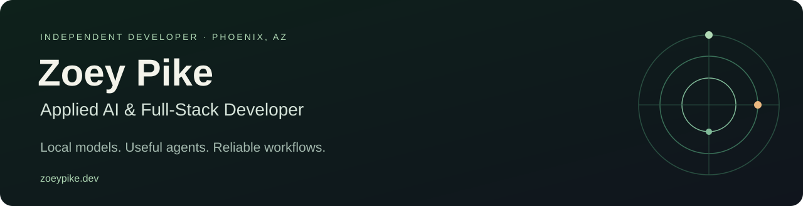

  <a href="https://zoeypike.dev"><strong>Portfolio</strong></a> &nbsp;·&nbsp;
  <a href="https://learnspanishforreal.com">Learn Spanish For Real</a> &nbsp;·&nbsp;
  <a href="https://cactusdrop.app">CactusDrop</a> &nbsp;·&nbsp;
  <a href="mailto:zo@zoeypike.dev">Get in touch</a>

### Hi, I'm Zo.

I turn ideas into working software: local AI agents, connected business tools, and full-stack applications. My work brings together **AI orchestration, API integration, and practical product development**, with a focus on making complex workflows easier to use and maintain.

Based in Phoenix, Arizona. Open to remote and Arizona-based opportunities in applied AI, automation, and full-stack development.

### What I'm building

| Project | What it does | What I bring |
| :--- | :--- | :--- |
| **[ZoLocalAI](zolocalai.md)** | A local AI workspace with offline voice, coding tools, and agent orchestration | LLM integration, context management, resumable workflows |
| **[Slice of Pi](slice-of-pi.md)** | Connects content, CRM, email, scheduling, and publishing in one desktop workspace | Workflow automation, API integration, traceable execution |
| **[Learn Spanish For Real](learn-spanish-for-real.md)** | Combines voice study, lessons, and personalized learning progress | Full-stack development, authentication, data synchronization |
| **[CactusDrop](cactusdrop.md)** | Direct file transfers and authenticated storage workflows | WebRTC, file integrity, cloud and native integration |

### How I work

I take projects from requirements through implementation, debugging, and release checks. I build with **Codex and my own ZoLocalAI harness**, reviewing generated code and testing how the system behaves. My background in estimating, customer support, and translation helps me clarify needs and explain technical work in English and Spanish.

### Core toolkit

**Build:** JavaScript · Node.js · Python scripting · SQL · Vite · Electron  
**Connect:** REST APIs · Supabase · PostgreSQL · SQLite · Cloudflare Workers / R2  
**AI & quality:** Ollama · Local speech tools · Context management · Playwright · Git

**[Explore my portfolio →](https://zoeypike.dev)** &nbsp;·&nbsp; **[Let's talk](mailto:zo@zoeypike.dev)**

Product showcases and engineering notes. Product source code is private.
