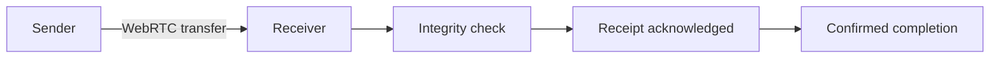

[← Profile](README.md)

# CactusDrop
### File transfers with a clear definition of done.

I built direct-transfer and authenticated storage workflows for CactusDrop, connecting browser, cloud, and Apple-native file handling.

## What I built

- **Direct transfers:** WebRTC data channels with Cloudflare Workers/D1 pairing and signaling.
- **Verified receipt:** bounded chunks, SHA-256 integrity checks, and receiver acknowledgement.
- **User control:** sender/recipient consent and fingerprint-code comparison.
- **Storage integration:** account-authorized R2 signed URLs and multipart upload operations.
- **Native file handling:** Swift save/import bridges for Apple workflows.

## Engineering highlight

The direct-transfer flow reports completion after the receiver verifies and acknowledges the file. That makes successful delivery an explicit protocol state rather than an assumption based on bytes sent.

**Validation:** protocol and regression checks cover consent, exact-byte receipt, cancellation, and integrity rejection.

**Stack:** WebRTC · Cloudflare Workers / D1 / R2 · Supabase · Swift

*Direct transfer and private storage are separate implementation paths.*

**[Explore CactusDrop →](https://cactusdrop.app)**

[Portfolio](https://zoeypike.dev) · [Contact](mailto:zo@zoeypike.dev)

Proprietary product. Source code is private.
