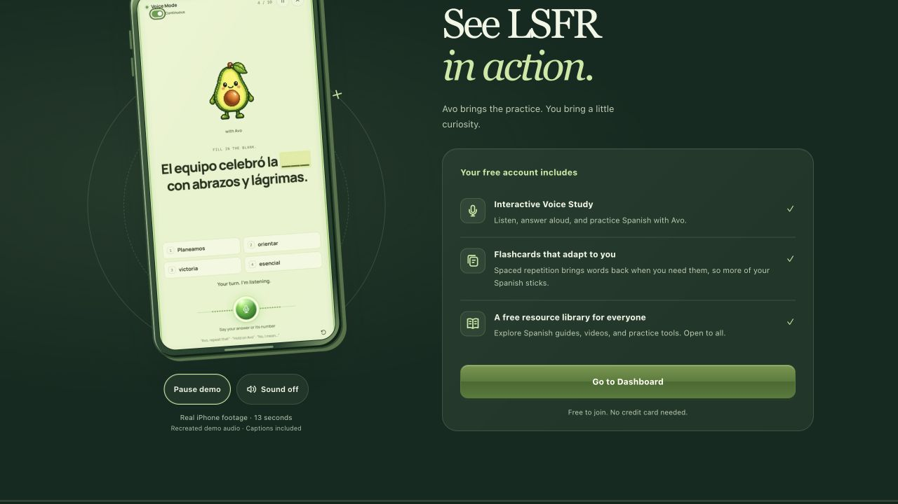
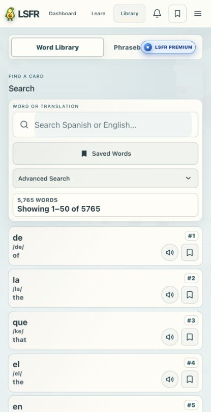

[← Profile](README.md)

# Learn Spanish For Real
### Turning language practice into a connected learning experience.

I built Learn Spanish For Real to bring voice study, spaced repetition, lessons, quizzes, and progression together in a cloud-backed application.

*Voice-study demonstration · November 6, 2026.*

## What I built

- **Learning experiences:** voice practice, vocabulary study, lessons, and progress tracking.
- **Account-backed data:** Supabase authentication and PostgreSQL ownership policies.
- **Progress synchronization:** retryable learning events help retain work through interrupted connections.
- **Subscription integration:** RevenueCat/Stripe with server-verified access.
- **User-journey checks:** regression coverage for authentication, learning state, voice transitions, and billing-related behavior.

## Engineering highlight

I connected the learning interface to explicit account and access rules. Progress synchronization handles interrupted connections, while database policies and server-side entitlement checks govern access.

*Mobile word library · November 22, 2026.*

**Stack:** JavaScript · Vite · Supabase · PostgreSQL · RevenueCat / Stripe · Browser testing

**[Explore Learn Spanish For Real →](https://learnspanishforreal.com)**

[Portfolio](https://zoeypike.dev) · [Contact](mailto:zo@zoeypike.dev)

Proprietary product. Source code is private.
