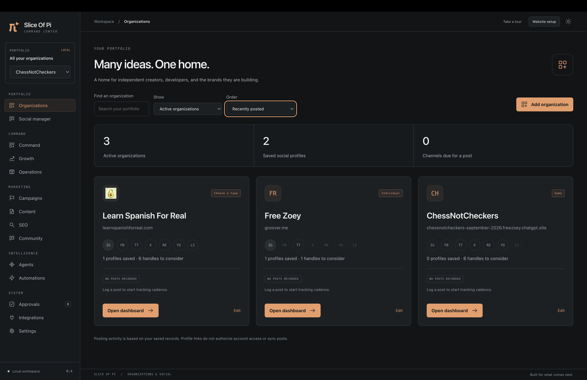
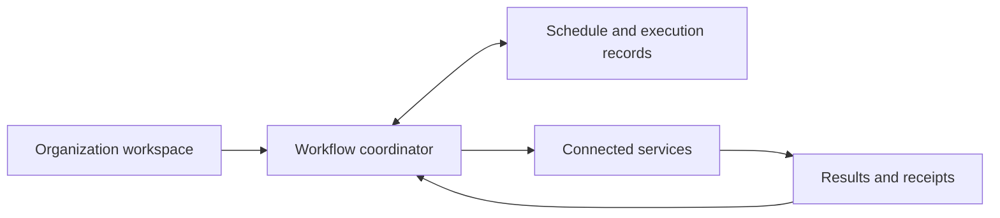

[← Profile](README.md)

# Slice of Pi Command Center
### Connecting daily business work in one place.

I built Slice of Pi as an Electron desktop workspace for content, CRM, email, scheduling, publishing, and analytics. It brings related workflows together while keeping each organization's accounts and execution records scoped to that organization.

*Earlier workspace interface.*

## What I built

- **Connected operations:** content libraries, CRM, email, communications adapters, and analytics.
- **Persistent scheduling:** SQLite transactions record CRM changes and execution markers together.
- **Recoverable publishing:** account/content checks and destination receipts preserve confirmed work through retries.
- **Clear handoffs:** assisted steps stay visible when a platform requires user interaction.

## Engineering highlight

An interrupted workflow should be able to continue without repeating completed actions. I designed execution tracking and publishing recovery around that requirement, giving the user a record of what finished and what still needs attention.

**Stack:** Electron · Vite · Node.js · SQLite · APIs · IMAP/SMTP

*In active development. Automation and assisted steps vary by provider.*

[Portfolio](https://zoeypike.dev) · [Contact](mailto:zo@zoeypike.dev)

Proprietary product. Source code is private.
