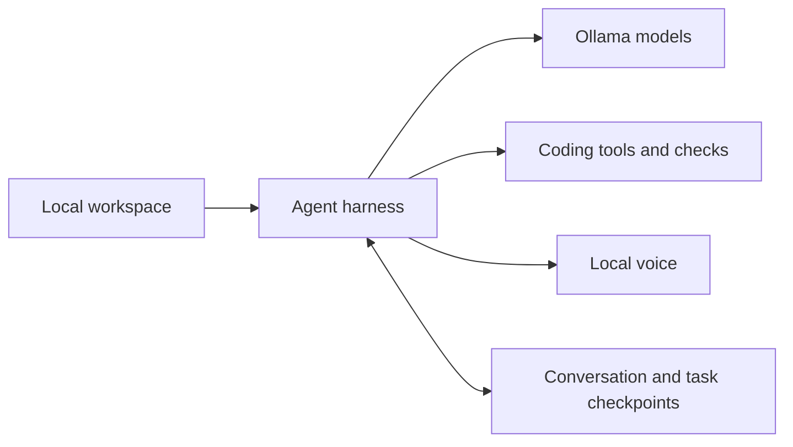

[← Profile](README.md)

# ZoLocalAI
### Bringing local AI, voice, and coding tools into one workspace.

I built ZoLocalAI to connect local language models with persistent conversations, tool execution, and multistep coding workflows. It combines a Node.js/Ollama harness with offline speech recognition and synthesis.

## What I built

- **Model orchestration:** routing, runtime settings, worker queues, and cancellation for local Qwen/DeepSeek inference.
- **Work that can resume:** context compaction, saved partial output, and durable checkpoints across interruptions.
- **Tools with verification:** structured file plans, hash-checked edits, browser assertions, and bounded repair loops.
- **Local voice:** Whisper/Kokoro ONNX integration for speech input and output.

## Engineering highlight

A useful agent needs to retain more than chat history. ZoLocalAI preserves task goals, source fingerprints, partial files, and failing checks so continuation has a concrete starting point.

**Validation:** 15 runtime-policy tests and eight deterministic backend scenarios cover routing and recovery behavior. Separate Mac hardware checks exercised short 27B inference and generated JavaScript execution.

**Stack:** Node.js · Ollama · Python integration · Whisper/Kokoro ONNX · Browser testing

*In active development. Built around pretrained models.*

[Portfolio](https://zoeypike.dev) · [Contact](mailto:zo@zoeypike.dev)

Proprietary product. Source code is private.
